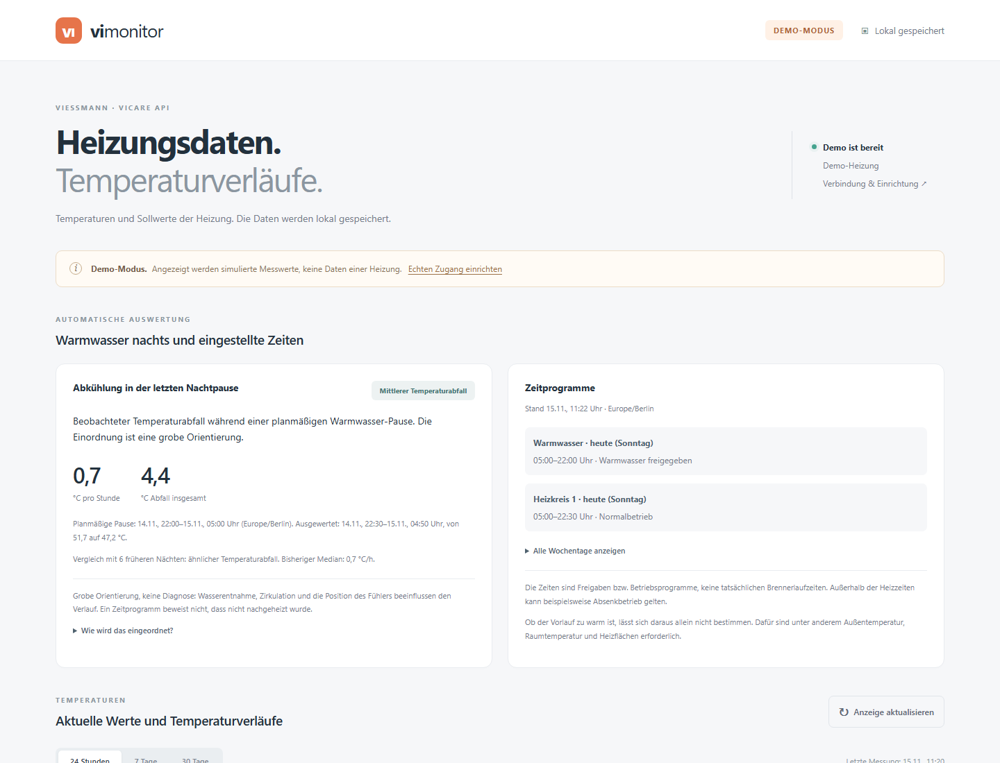
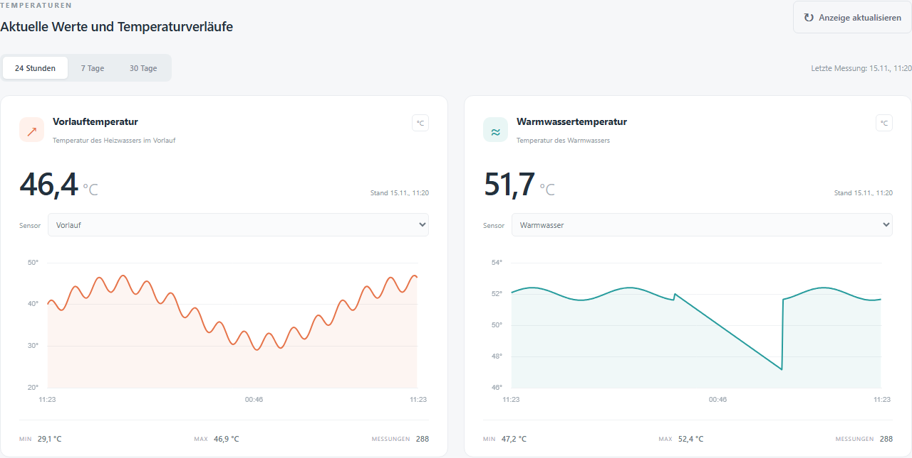
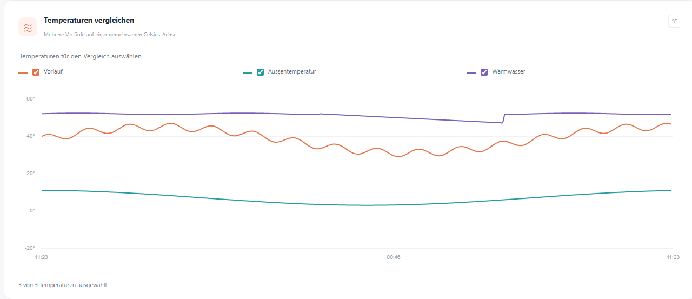

# ViMonitor

Lokale Web-App fuer Temperaturverlaeufe einer Viessmann-Heizung: **Vorlauf,
Warmwasser und weitere verfuegbare Celsius-Sensoren**, dauerhaft in SQLite
gespeichert. Deutsches Dashboard mit Sensorwahl, 24-Stunden-, 7-Tage- und
30-Tage-Ansicht.

**Version 1.1.0** · [Release und Quellcode herunterladen](https://github.com/flottokarotto/vimonitor/releases/tag/v1.1.0)

> Die App startet standardmaessig im deutlich gekennzeichneten **Demo-Modus**.
> Echte Messwerte gibt es erst nach Einrichtung eines eigenen Viessmann-API-Clients.
> ViMonitor ist ein unabhaengiges Projekt, kein offizielles Viessmann-Produkt.

## Screenshots

Alle Aufnahmen zeigen ausschliesslich synthetische Demodaten, keine Messwerte
oder Zugangsdaten einer echten Anlage.

### Automatische Nacht-Auswertung und Zeitprogramme

Temperaturabfall pro Stunde, grobe Einordnung und eingestellte Heiz- und
Warmwasserzeiten ohne zusaetzliche Konfiguration.



### Vorlauf und Warmwasser

Einzelne Temperaturverlaeufe mit Sensorwahl, Zeitraum und Messwert-Uebersicht.



### Mehrere Temperaturen vergleichen

Ausgewaehlte Sensoren gemeinsam auf einer Celsius-Achse.



## Schnellstart unter Windows

Voraussetzungen: **Node.js >= 24.12** und npm. Im Projektordner in PowerShell:

```powershell
npm ci
Copy-Item .env.example .env
npm run build
npm start
```

Dann **http://localhost:3000** oeffnen. Im Demo-Modus werden sieben Tage
synthetischer Daten in einer eigenen SQLite-Datei erzeugt. Die App laeuft,
solange das Terminal offen ist; `Strg+C` beendet sie. Fuer Entwicklung:

```powershell
npm run dev
```

Fuer Web- und Terminal-Dashboard gleichzeitig nach dem Build `npm run tui`
starten. Beide Oberflaechen verwenden dabei denselben Server, Collector und
SQLite-Speicher.

Das Dashboard verwendet React und wird mit esbuild lokal gebuendelt. `npm run
dev` erstellt das Frontend beim Start und ueberwacht den Server. Fuer laufende
Frontend-Aenderungen zusaetzlich in einem zweiten Terminal `npm run dev:ui`
starten und die Seite nach Aenderungen neu laden. Fuer den normalen Betrieb
nach einer Quellcode-Aenderung `npm run build` ausfuehren.

Die React-Oberflaeche ist in `frontend/` organisiert: `main.tsx` setzt die
Dashboard-Bereiche zusammen, `use-dashboard.ts` verwaltet API-Aufrufe und
Ansichtsdaten, und einzelne Komponenten kapseln Einrichtung, Messkarten,
Vergleichsdiagramm und Auswertung.

`npm run tui` startet nach `npm run build` den Webserver und zusaetzlich ein
interaktives Terminal-Dashboard mit [Blessed](https://piranna.github.io/blessed/)
und `blessed-contrib`-Liniencharts. Beide Oberflaechen teilen sich denselben
Collector, dieselbe SQLite-Datenbank und denselben Port. Die Anmeldung oeffnet
ViCare im Browser. Tasten: `q` schliesst nur das TUI, `Strg+C` beendet Server
und TUI, `r` aktualisiert, `1`/`2`/`3` waehlt den Zeitraum, `a` wechselt die
aktive Heizung, `d` oeffnet die Geraeteauswahl, `c` die Vergleichssensoren,
`f`/`w` wechselt den Messsensor und `l` oeffnet die ViCare-Anmeldung. In
Auswahlfenstern navigieren Hoch/Runter und Bild auf/ab durch die Liste;
Links/Rechts scrollt lange Namen horizontal. `Enter` oder die Leertaste
schaltet einen Eintrag um, `s` speichert und `Esc` schliesst. Ein Live-Protokoll
ist direkt im TUI sichtbar.
Die Charts nutzen den verfuegbaren Platz direkt unter dem Status; Auswertung
und Logs bleiben in einem kompakten, per Maus scrollbar bedienbaren unteren Bereich.
Beim Aendern der Terminalgroesse werden die Diagramme neu gezeichnet.
Die Vergleichslegende steht rechts neben dem Diagramm mit vollstaendigen,
umgebrochenen Namen in den jeweiligen Kurvenfarben. Mit dem Mausrad oder
`g` und anschliessend Hoch/Runter bzw. Bild auf/ab scrollen; `Esc` gibt den
Tastaturfokus zurueck.

Die Viessmann-Anbindung kapselt OAuth, Token-Erneuerung, HTTP und die
Uebersetzung der Feature-Antworten. Anwendung und Datenerfassung verwenden
typisierte Heizungs-Schnittstellen; der Client benoetigt nur eine Schnittstelle
fuer die Token-Speicherung. SQLite bleibt die konkrete lokale Speicherung.

Der Server lauscht ausschliesslich auf `127.0.0.1`. Es ist keine Firewallfreigabe
noetig. Die App ist nicht fuer einen oeffentlichen Webserver, LAN-Zugriff oder
einen ungeschuetzten Reverse-Proxy ausgelegt.

## Eigene Heizung verbinden

1. Die Heizung muss bereits im eigenen **ViCare-Konto** erreichbar sein.
2. Im [Viessmann-Developer-Portal](https://app.developer.viessmann-climatesolutions.com)
   mit diesem Konto anmelden und unter **Your clients** einen API-Client anlegen.
3. Als Redirect-URI exakt **`http://localhost:3000/auth/callback`** eintragen.
   Den oeffentlichen Client mit **PKCE / S256** verwenden, sofern das Portal nach
   dieser Einstellung fragt. Die App verwendet keinen Client-Secret.
4. Die erzeugte Client-ID nur in die lokale Datei `.env` eintragen:

   ```dotenv
   DEMO_MODE=false
   VIESSMANN_CLIENT_ID=deine-client-id
   VIESSMANN_REDIRECT_URI=http://localhost:3000/auth/callback
   ```

5. App neu starten. Im Dashboard unter **Verbindung & Einrichtung** auf
   **Mit Viessmann verbinden** klicken. Ausschliesslich auf der Viessmann-Seite
   anmelden; die App verlangt kein ViCare-Passwort.
6. Nach der Rueckleitung ein oder mehrere Heizgeraete auswaehlen und **Auswahl speichern**
   anklicken. Auch bei nur einem Geraet wird die Auswahl bestaetigt.
   Kommunikationsmodule (`E3_TCU...`) und Raumregelungsmodule
   (`E3_RoomControl...`) werden aus der Auswahl ausgeblendet.

Die App verwendet OAuth Authorization Code mit PKCE, einem einmaligen,
cookiegebundenen State und den Scopes `IoT User offline_access`. Access-Tokens
werden automatisch mit dem Refresh-Token erneuert. Bei widerrufener Freigabe
erneut anmelden. Offene Anmeldungen verfallen nach zehn Minuten; ein Neustart
verwirft sie.

Welche Features verfuegbar sind, haengt vom Heizungsmodell, Gateway und gebuchten
API-Paket ab. Das [Developer-Portal](https://developer.viessmann-climatesolutions.com/)
und die [offizielle API-Dokumentation](https://api.viessmann-climatesolutions.com/documentation)
sind fuer Freigaben und aktuelle Limits massgeblich. Eine kostenlose Verfuegbarkeit
bestimmter Datenpunkte wird nicht vorausgesetzt.

Der lesende Zugriff wurde an einer Vitodens-Anlage erprobt. Das ist keine
Kompatibilitaetszusage fuer andere Anlagen. Automatisierte Tests verwenden
simulierte API-Antworten; im Demo-Modus sind alle Werte synthetisch.

## Dashboard und Erfassung

- Automatische Messabfrage alle **fuenf Minuten**. Das sind 288 regulaere
  Feature-Abfragen **pro ausgewaehltem Heizgeraet** am Tag, zuzueglich Anmeldung
  und Geraeteerkennung. Mehrere Geraete erhoehen den API-Verbrauch entsprechend;
  das eigene API-Kontingent und etwaige Kosten beachten.
- Mehrere Heizgeraete desselben ViCare-Kontos koennen gleichzeitig erfasst
  werden. In der Einzelansicht und Nacht-Auswertung bestimmt die Heizungsauswahl
  das angezeigte Geraet; im Vergleichsdiagramm lassen sich Sensoren aller
  ausgewaehlten Heizungen gemeinsam darstellen. Bei einer Abfragebegrenzung
  wird die Erfassung pausiert und der Fehler angezeigt; bei sonstigen
  Geraetefehlern werden die uebrigen Heizungen weiter abgefragt.
- Haben Heizgeraete denselben Namen, ergaenzt die Anzeige eine kurze, aus der
  Geraeteidentitaet abgeleitete Kennung. Sie unterscheidet die Geraete in
  Auswahl, Vergleich und Fehlermeldungen, ohne die volle Gateway-Seriennummer
  anzuzeigen. Bei nur einem gleichnamigen Geraet entfaellt die Kennung.
- **Anzeige aktualisieren** liest nur die lokale Datenbank und verbraucht kein
  zusaetzliches Viessmann-Messkontingent.
- Beide Diagramme bieten eine Sensorwahl. Falls kein passender Vorlauf- oder
  Warmwassersensor existiert, wird dies angezeigt. Andere Sensoren lassen sich
  ausdruecklich manuell auswaehlen; Kesseltemperatur wird nicht als Vorlauf ausgegeben.
- Bekannte Temperaturdatenpunkte erhalten verstaendliche deutsche Namen, auch
  fuer bereits gespeicherte Messungen. Sollwerte und Temperaturgrenzen sind
  entsprechend gekennzeichnet. Die technische Kennung bleibt als Tooltip an der
  Sensorwahl erhalten; unbekannte Datenpunkte behalten ihre API-Bezeichnung.
- Vorlauf-Erkennung: `heating.primaryCircuit.sensors.temperature.supply` und
  `heating.circuits.<n>.sensors.temperature.supply`.
- Warmwasser-Erkennung: `heating.dhw.sensors.temperature.main` und
  `heating.dhw.sensors.temperature.hotWaterStorage`.
- Weitere aktivierte, bereite Features mit numerischen `celsius`-Properties
  werden ebenfalls aufgezeichnet. Rohantworten und Steuerbefehle werden nicht gespeichert.
- Zeitstempel sind **Abrufzeitpunkte in UTC**. Die Anzeige verwendet die
  Browser-Zeitzone; sie sind keine vom Sensor bestaetigten Messzeitpunkte.
- Maximal 601 Zeitbloecke pro Diagramm. Angezeigt werden Mittelwerte, im Tooltip
  auch Minimum, Maximum und Messanzahl. Messluecken werden nicht interpoliert.
- Y-Achsen zeigen gerundete Celsius-Werte mit hoechstens einer Nachkommastelle
  und deutschem Dezimalkomma; die gespeicherten Messwerte bleiben unveraendert.
- Im dritten Diagramm **Temperaturen vergleichen** lassen sich beliebige
  Temperaturdatenpunkte per Checkbox gemeinsam anzeigen, einschliesslich
  Sollwerten und Grenzwerten. Standardmaessig sind Vorlauf und Warmwasser
  ausgewaehlt. Alle Diagramme verwenden den oben gewaehlten Zeitraum.
  Farben (bei vielen Linien zusaetzlich Strichmuster) unterscheiden die
  Verlaeufe; der Tooltip nennt den Datenpunkt. Die Auswahl bleibt beim
  automatischen Aktualisieren erhalten, wird beim Neuladen zurueckgesetzt.
  Identische Historien werden pro Aktualisierung nur einmal lokal abgefragt;
  es entstehen keine zusaetzlichen Viessmann-API-Abfragen.
- Abfragen laufen nicht parallel. Fehler erzeugen keine Ersatzmesswerte.
  Wiederholungsversuche erfolgen mit wachsender Pause bis zu einer Stunde;
  ein laengeres `Retry-After` der API wird ebenfalls beachtet.
- Bei `DEVICE_COMMUNICATION_ERROR` wird dasselbe Geraet zusaetzlich sofort nach
  10 und 30 Sekunden erneut abgefragt. Schlaegt auch der dritte Versuch fehl,
  folgt der regulaere, mit Fehlern wachsende Abfrageabstand.
- Die Konsolenausgabe enthaelt lokale Zeitstempel, Schweregrade und farbige
  Meldungen in Terminals, die ANSI-Farben unterstuetzen. `NO_COLOR` deaktiviert
  die Farben; `FORCE_COLOR=1` erzwingt sie.
- Daten aelter als 2,5 Abfrageintervalle werden als veraltet markiert.
- Bei geschlossenem Terminal, ausgeschaltetem PC oder Standby findet keine
  Erfassung statt. Die API liefert hier nur aktuelle Werte; fehlende historische
  Messungen werden nach einem Neustart nicht nachgeladen.
- Es gibt keine automatische Loeschung alter Daten. Fuer kontinuierliche
  Langzeitmessungen ist spaeter ein dauerhaft laufender Rechner sinnvoll.

## Automatische Nacht-Auswertung und Zeitprogramme

Ohne Einstellungen zeigt die Uebersicht die heutigen Warmwasser- und Heizzeiten
sowie eine aufklappbare Wochenansicht. Sie werden bei derselben Feature-Abfrage
wie die Temperaturen gelesen, ohne zusaetzliche API-Requests. Freigabezeitfenster
sind keine tatsaechlichen Brennerlaufzeiten; ausserhalb der Heizzeiten kann
beispielsweise Absenkbetrieb gelten.

Die Wochenprogramme werden mit Abrufzeitpunkt und Abfrageintervall in
`schedule_snapshots` gespeichert. Aktuelle Programme werden **nicht nachtraeglich
auf unbekannte fruehere Naechte angewendet**. Fehlende, ungueltige, deaktivierte
oder veraltete Programme verhindern eine Bewertung und werden angezeigt.
Zeitprogramme und Nachtgrenzen beziehen sich auf **Europe/Berlin** einschliesslich
Sommer-/Winterzeit, unabhaengig von der Browser- oder Server-Zeitzone. Diese
Version ist fuer Anlagen mit dieser Ortszeit ausgelegt.

### Berechnung

- Automatische Wahl des Warmwasser-Istfuehlers: `hotWaterStorage`, dann `main`,
  dann `dhwCylinder`. Sollwerte werden nicht als Isttemperatur ausgewertet.
- Pro Nacht wird die laengste abgeschlossene Warmwasser-Pause im Abschnitt
  18–10 Uhr betrachtet, mit mindestens zwei Stunden Pausendauer. Das kann bei
  einer laengeren Pause auch nur der naechtliche Ausschnitt sein.
- Betrachtet werden maximal die letzten 14 Naechte. Die aktuelle Nacht wird erst
  nach Abschluss ihrer erkannten Pause bewertet.
- Die ersten 30 Minuten nach Freigabeende und die letzten zehn Minuten vor der
  naechsten Freigabe bleiben unberuecksichtigt. Danach sind mindestens zwei
  Stunden Messdauer und sechs echte, unaggregierte Messwerte erforderlich.
- Messwerte muessen bis auf 2,5 Abfrageintervalle, maximal 15 Minuten, an die
  Auswertungsgrenzen heranreichen. Auch zwischen Messwerten bzw. beobachteten
  Zeitprogrammen sind keine groesseren Luecken zulaessig.
- Programmwechsel in der Pause, Temperaturanstiege ab 0,5 °C je Messschritt,
  aufsummierte Anstiege ab 1 °C oder abrupte Abfaelle ab 2 °C je Messschritt
  schliessen die Bewertung aus. Diese Filter koennen Stoerungen erkennen, aber
  nicht jede Entnahme oder Nachheizung ausschliessen.
- Temperaturabfall = erster minus letzter Messwert. Abkuehlrate = Abfall geteilt
  durch die tatsaechlich vergangene Zeit in Stunden, auch bei Zeitumstellung.
- Vergleich mit dem Median von mindestens drei frueheren auswertbaren Naechten,
  deren Starttemperatur hoechstens 5 °C und Pausendauer hoechstens 25 % abweicht.
  Als schneller/langsamer gilt eine Abweichung ueber 25 % des Medians und
  zugleich ueber 0,2 °C/h; sonst wird der Verlauf als aehnlich beschrieben.

### Grobe Einordnung und Grenzen

Die folgenden Stufen sind **projektinterne Orientierung, keine Normwerte,
Herstellervorgaben oder Hygienegrenzwerte**:

| Beobachteter Temperaturabfall | Anzeige |
|---|---|
| bis einschliesslich 0,5 °C/h | Geringer Temperaturabfall |
| ueber 0,5 bis einschliesslich 1,5 °C/h | Mittlerer Temperaturabfall |
| ueber 1,5 °C/h | Staerkerer Temperaturabfall |

Ein staerkerer Abfall belegt **keinen Defekt oder unnoetigen Energieverbrauch**.
Wasserentnahme, Zirkulation und Temperaturschichtung am Fuehler beeinflussen den
Messwert. Aus einem Fuehlerverlauf laesst sich kein zuverlaessiger Energieverlust
des gesamten Speichers berechnen. Warmwasser-Sollwerte nicht allein anhand der
Anzeige absenken; Anforderungen an die Trinkwasserhygiene beachten.

Ob der Vorlauf zu warm ist, laesst sich aus Zeitprogramm und Vorlauftemperatur
allein ebenfalls nicht beurteilen. Dazu sind insbesondere Raumtemperaturen,
Aussentemperatur und Heizflaechen noetig. Die App behauptet deshalb keine
automatische Heizkurven-Diagnose.

## Lokale Konfiguration

| Variable | Standard | Bedeutung |
|---|---|---|
| `DEMO_MODE` | `true` | Nur `true` oder `false`; Demo und echte Daten bleiben getrennt |
| `PORT` | `3000` | Lokaler Port, 1024 bis 65535 |
| `POLL_INTERVAL_SECONDS` | `300` | Ganzzahlig, mindestens 300, maximal 86400 |
| `DATA_DIR` | `./data` | Datenverzeichnis, relativ zum Arbeitsverzeichnis |
| `VIESSMANN_CLIENT_ID` | leer | Im echten Modus erforderlich |
| `VIESSMANN_REDIRECT_URI` | `http://localhost:<PORT>/auth/callback` | Muss zum Port und zum Portal-Eintrag passen |

Nach Konfigurationsaenderungen den Server neu starten; fuer reine
Konfigurationsaenderungen ist kein neuer Build erforderlich.

## Datenhaltung und Datenschutz

```text
data/
  vimonitor.sqlite    echte Messwerte, Geraetewahl und verschluesselte Tokens
  demo.sqlite         ausschliesslich Demo-Daten
  token.key           lokaler AES-256-GCM-Schluessel
```

SQLite wird fuer Echt- und Demo-Datenbanken immer im **WAL-Modus** betrieben,
vor Anwendung von Schema-Migrationen. Bei jedem Oeffnen wird der Modus gesetzt und
geprueft; kann WAL nicht aktiviert werden, bricht der Start mit einer
Fehlermeldung ab. Dabei koennen zusaetzlich `-wal`- und `-shm`-Dateien entstehen.
`synchronous=FULL` sichert bestaetigte Transaktionen auch bei Stromausfall ab,
soweit Betriebssystem und Speichermedium die Synchronisierung korrekt umsetzen.
Ein `busy_timeout` von fuenf Sekunden puffert kurzzeitige Schreibsperren.

Das normalisierte Schema verwendet:

- `devices`: Geraete mit numerischem Primaerschluessel und eindeutiger Kombination
  aus Installation, Gateway und Geraetekennung.
- `selected_devices` und `active_device`: geordnete Erfassungsauswahl und aktive
  Heizung; eine aktive Heizung muss zur Auswahl gehoeren.
- `sensors`: Sensor-Metadaten pro Geraet, mit numerischen IDs.
- `readings`: Rohmesswerte, eindeutig nach Sensor-ID und UTC-Zeitstempel in
  Millisekunden. Der Primaerschluessel unterstuetzt Bereichsabfragen direkt.
- `schedule_programs`: pro Geraet deduplizierte Zeitprogramm-JSON-Dokumente.
- `schedule_snapshots`: jeder beobachtete Zeitpunkt mit Programmreferenz,
  Abfrageintervall und etwaigem Fehler; auch unveraenderte Programme werden
  weiterhin zeitlich lueckenlos nachgewiesen.
- `settings`: lokale Einstellungen und verschluesselte Tokens, keine Geraetewahl.

Alle Tabellen sind `STRICT`. Fremdschluessel verhindern verwaiste Messwerte
und geraetefremde Programmzuordnungen. `CHECK`-Regeln begrenzen Sensortypen,
Zeitstempel, endliche Messwerte, positive Abfrageintervalle und gueltige
Zeitprogramm-JSON-Arrays. Messwerte und Zeitprogramme einer erfolgreichen
Geraeteabfrage werden in **einer Transaktion** gespeichert. Nur identische
Messschluessel werden gezielt ignoriert; andere Constraint-Verletzungen sind
Fehler. Historien bleiben beim Abwaehlen oder erneuten Anmelden erhalten.

Die Schema-Version steht in SQLite unter `PRAGMA user_version` (aktuell **2**),
unabhaengig von der App-Version. Beim Start werden ausstehende Migrationen in
einer gemeinsamen Transaktion angewendet. Bisherige unversionierte Datenbanken
(Version 0), auch ohne `schedule_snapshots`, und Version 1 werden automatisch
uebernommen. Vor der Migration einer vorhandenen Datenbank wird unter
`DATA_DIR/backups/` ein konsistentes, integritaetsgeprueftes Backup inklusive
`token.key` angelegt. Schlaegt die Sicherung fehl, startet die Migration nicht.
Zeilenanzahlen, Datenbankintegritaet und Fremdschluessel werden beim Umstieg
geprueft. Ungueltige Altdaten fuehren zum Abbruch, nicht zu stiller Bereinigung.
Bei Fehlern werden Schema-Aenderungen und
Versionsnummer gemeinsam zurueckgerollt; neuere, nicht unterstuetzte
Schema-Versionen verhindern den Start mit einer Fehlermeldung. Das gilt fuer
Echt- und Demo-Datenbanken. **Vor Updates alle laufenden ViMonitor-Prozesse
beenden**, damit kein alter Prozess nach dem Umstieg auf das alte Schema zugreift.
Kuenftige Schema-Aenderungen werden als weitere Migration am Ende von
`migrations` in `src/store.ts` ergaenzt; bestehende Migrationen bleiben unveraendert.
Version 2 ist in `src/schema.ts` definiert. Ein Downgrade auf eine App mit
Schema-Version 1 benoetigt das Backup vor der Migration.

`.env`, das gesamte Datenverzeichnis, Datenbankdateien und Logs werden von Git
ausgeschlossen. Vor eigenen Commits trotzdem `git status` pruefen, besonders bei
einem benutzerdefinierten `DATA_DIR`. **Keine Datenbank, Tokens, Schluessel,
Client-IDs oder Anlagenkennungen auf GitHub hochladen.**

Tokens werden in SQLite verschluesselt; **die Messdaten selbst nicht**. Wer
Datenbank und Schluessel lesen kann, kann die Tokens entschluesseln. Die
Verschluesselung ersetzt daher keine Betriebssystemrechte. Das Datenverzeichnis
unter Windows nur dem eigenen Benutzer zugaenglich machen (Dateieigenschaften >
Sicherheit), insbesondere auf gemeinsam genutzten Rechnern. Es werden keine
Analyse-, CDN- oder Telemetriedienste eingebunden. Chart.js wird lokal ausgeliefert.

### Backup und Wiederherstellung

Nach `npm run build` kann auch bei laufender Erfassung ein konsistenter
SQLite-Snapshot erstellt werden (einschliesslich bereits bestaetigter WAL-Daten):

```powershell
npm run backup -- C:\ViMonitor-Backups\2026-11-17
```

Das Ziel muss neu sein; vorhandene Verzeichnisse werden nicht ueberschrieben.
Die Auswahl von Echt- oder Demo-Datenbank richtet sich wie beim Server nach
`.env`/`DEMO_MODE` und `DATA_DIR`. `VACUUM INTO` erstellt den Snapshot;
`integrity_check` und `foreign_key_check` pruefen ihn. Gesichert werden die
gewaehlte Datenbank und `token.key`, nicht `.env` oder die jeweils andere
Datenbank. Beide Datenbanken bei Bedarf getrennt sichern. Ein fehlgeschlagenes
Backup wird ausdruecklich gemeldet; ein eventuell angelegtes unvollstaendiges
Zielverzeichnis ist kein gueltiges Backup.

Zur Wiederherstellung alle App-Prozesse beenden, `.env` behalten und `DATA_DIR`
auf ein separates Wiederherstellungsverzeichnis mit der gesicherten Datenbank
und `token.key` setzen. Keine alten `-wal`-/`-shm`-Dateien dazumischen. Erst nach
Pruefung der Historien die bisherige Datenkopie ersetzen. Ohne den passenden
Schluessel koennen vorhandene Tokens nicht wiederhergestellt werden.

Backups und Schluessel nur in geschuetzten Verzeichnissen ausserhalb des Repos
aufbewahren; automatische Migrationsbackups ersetzen keine regelmaessige
Sicherung auf einem anderen Datentraeger. Es gibt bewusst keine automatische
Loeschung oder Verdichtung der Rohmesswerte und keine automatische Loeschung
alter Backups. Den Speicherverbrauch deshalb regelmaessig kontrollieren.

## Entwicklung und Tests

```powershell
npm run typecheck
npm test
npm run build
```

Die Tests verwenden temporaere Datenbanken und simulierte HTTP-Antworten, keine
echten Viessmann-Zugaenge. GitHub Actions fuehrt sie unter Windows und Linux aus.

| Bereich | Datei |
|---|---|
| Umsetzungsplan | [PLAN.md](PLAN.md) |
| OAuth und Viessmann-API | [src/viessmann.ts](src/viessmann.ts) |
| Messzyklus und Demo-Daten | [src/collector.ts](src/collector.ts) |
| Zeitprogramme und Nacht-Auswertung | [src/schedules.ts](src/schedules.ts), [src/insights.ts](src/insights.ts) |
| SQLite und Tokenverschluesselung | [src/store.ts](src/store.ts) |
| Lokale HTTP-Endpunkte | [src/app.ts](src/app.ts) |
| React-Dashboard | [frontend/](frontend/), statische Assets in [public/](public/) |

## Lizenz

Der eigene Projektcode steht unter der [MIT-Lizenz](LICENSE).
Nutzung, Aenderung und Weitergabe sind auch kommerziell erlaubt, sofern der
Urheberrechts- und Lizenzhinweis erhalten bleibt. Die Software wird ohne
Gewaehrleistung bereitgestellt; massgeblich ist der Lizenztext.

Abhaengigkeiten unterliegen ihren jeweiligen eigenen Lizenzen. Die MIT-Lizenz
erteilt keine Rechte an Viessmann-Marken oder am API-Dienst und ersetzt nicht
die Nutzungsbedingungen des API-Anbieters.

## Fehlerbehebung

- **Port belegt:** `PORT` aendern, passende Redirect-URI in `.env` und im
  Developer-Portal eintragen.
- **HTTP 401 / Anmeldung abgelaufen:** erneut bei Viessmann anmelden.
- **HTTP 403 von Viessmann:** API-Paket, Freigaben und verwendetes Konto pruefen.
- **HTTP 429:** Abfragelimit erreicht. Wiederholungspause abwarten, Intervall ggf.
  erhoehen und andere Apps mit demselben Konto beruecksichtigen.
- **`DEVICE_COMMUNICATION_ERROR`:** Viessmann meldet einen Kommunikationsfehler
  fuer das Geraet. ViMonitor versucht es nach 10 und 30 Sekunden erneut; bleiben
  alle Versuche erfolglos, pruefe die Erreichbarkeit in ViCare und warte den
  naechsten automatischen Abfrageversuch ab.
- **Keine Sensoren:** anderes Geraet waehlen oder die Feature-Freigaben pruefen.
  Nicht jedes aufgefuehrte Gateway-Geraet stellt Heizungsdaten bereit.
- **Fehler beim OAuth-Callback:** erneut unter `http://localhost:3000` anmelden.
  Kein Wechsel auf `127.0.0.1` waehrend der Anmeldung, da das State-Cookie an
  `localhost` gebunden ist.
- **SQLite nicht verfuegbar:** mit `node --version` die erforderliche Node-Version
  pruefen. Es wird kein zusaetzliches SQLite-Paket installiert.
